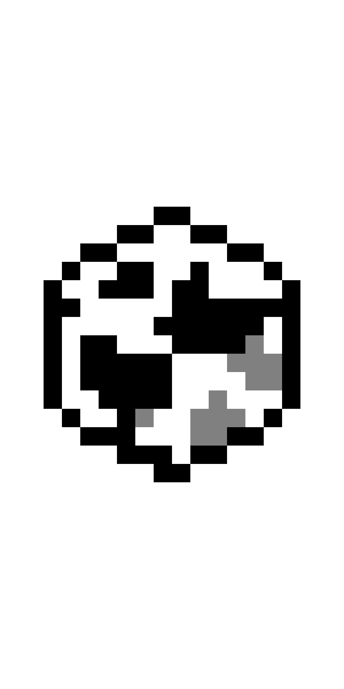

# Paul Sone Flag

## About

The **Paul Sone Flag** is a personal identity symbol representing Paul Sone and his creative work.

The flag is used across websites, online communities, digital projects, and other platforms associated with Paul Sone.

A square version of the flag is also used as a logo, including website favicons and project icons.

## Identity

- **Name:** Paul Sone Flag
- **Associated identity:** Paul Sone
- **Type:** Personal flag and visual identity
- **Symbol:** ⚪️🌐

## Official Usage

The flag serves as a recognizable symbol connecting different projects and creative works under the Paul Sone identity.

It may appear on websites, social media, Minecraft servers, applications, and other digital platforms.

## Usage Guidelines

Personal sharing, displaying the flag in messages, and non-commercial references to Paul Sone are welcome.

However, using the flag or its logo version as an independent brand identity, website logo, company logo, or project emblem requires prior permission.

The artwork is not offered under an open-source or Creative Commons license.

## Official Source

This repository documents the Paul Sone Flag and its association with Paul Sone.

The official website provides additional information about the symbol.

paulsone.com

## Contact

For permission requests or questions regarding the flag, please contact Paul Sone through his official channels.
